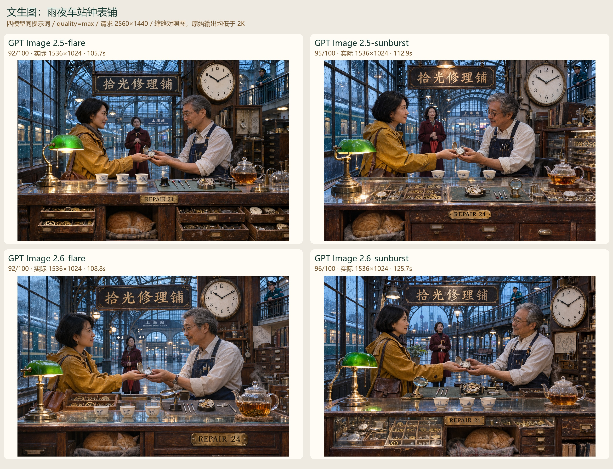
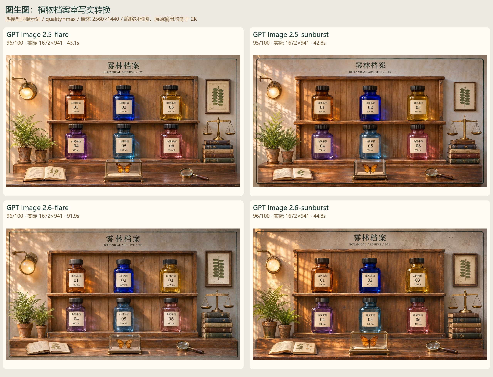
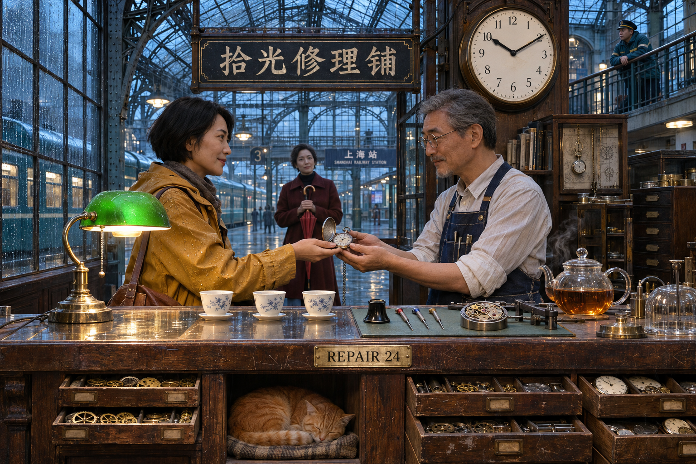
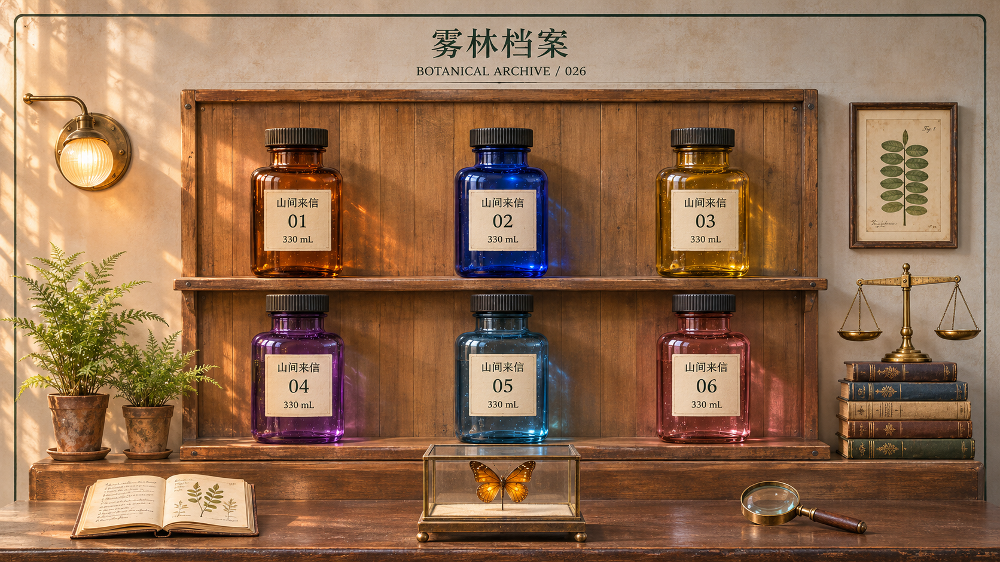
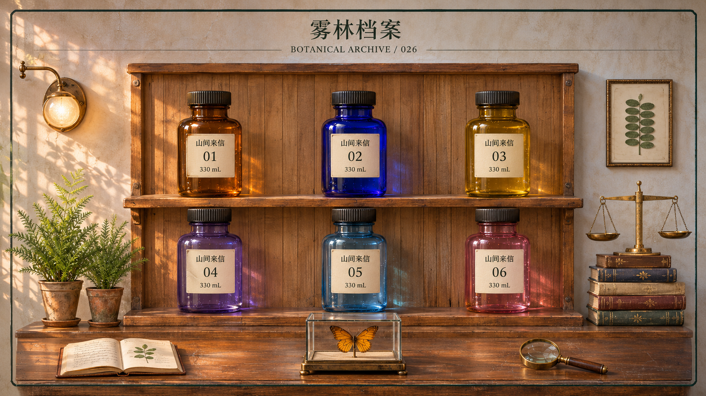
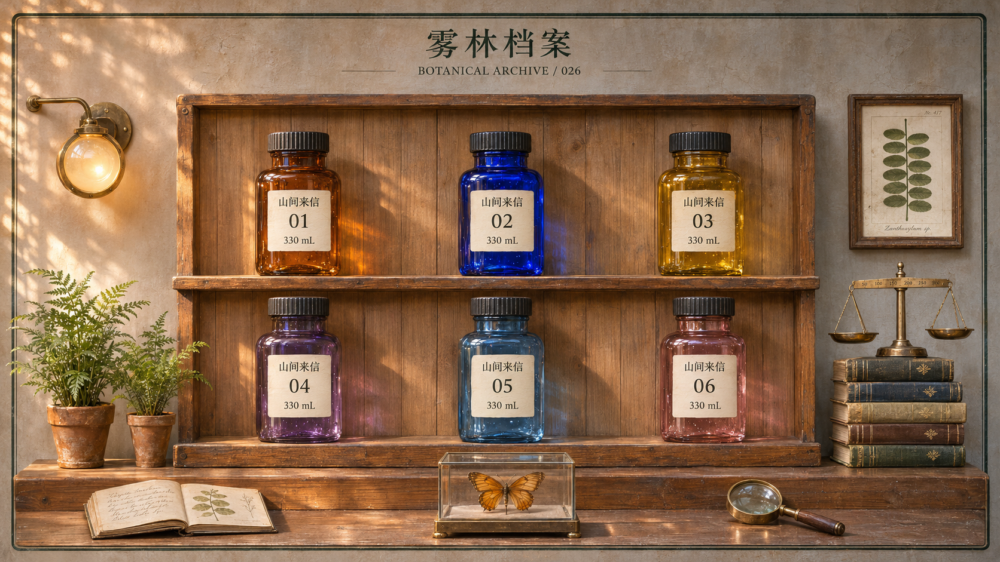
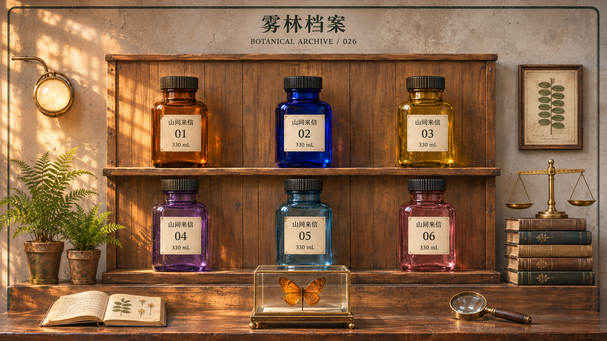
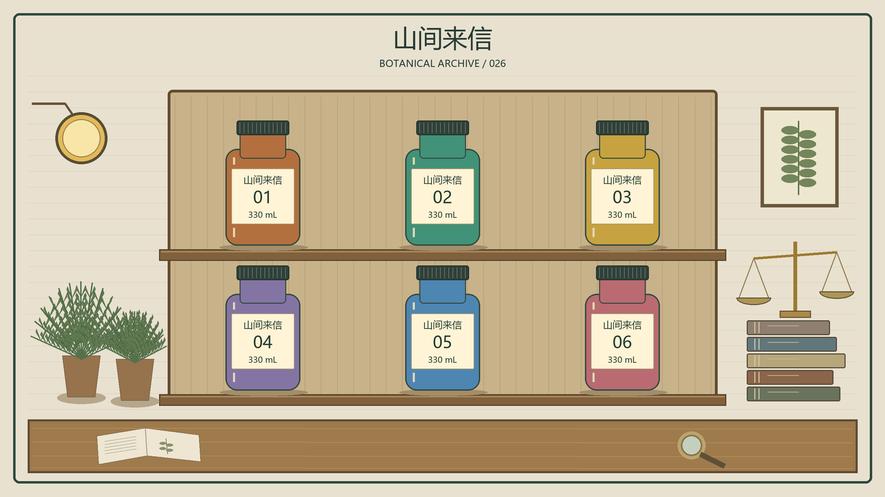

# GPT Image 2.5 / 2.6 同条件实测与评分

8 个条件均已取得可读图片；其中 3 个条件首轮 HTTP 503 后在本次补测成功。所有评分先按 A–D 代号完成，再揭示模型名。

**原生 2K 未达标：8/8 张原图都小于请求的 2560×1440。文生图实际为 1536×1024，图生图为 1672×941；没有放大或修图。以下是这些实际返回图片的画质评分，不能当作 2K 能力排名。**

| 请求模型 | 文生图 /100 | 图生图 /100 | 两项平均 | 文 / 图耗时（秒） | 2K |
|---|---:|---:|---:|---|---|
| gpt-image-2.5-flare | 92 | 96 | 94 | 105.7 / 43.1 | 未达标 |
| gpt-image-2.5-sunburst | 95 | 95 | 95 | 112.9 / 42.8 | 未达标 |
| gpt-image-2.6-flare | 92 | 96 | 94 | 108.8 / 91.9 | 未达标 |
| gpt-image-2.6-sunburst | 96 | 96 | 96 | 125.7 / 44.8 | 未达标 |

## 本轮判断

这组样本中，2.6 Sunburst 文生图 96、图生图 96，综合略高；2.5 Sunburst 为 95/95，差距很小。两版 Flare 都在文生图里增加了背景路人，违反精确四人的约束，所以该项均为 92；其图生图均为 96。

若只针对这次复杂场景及受控参考转换，暂选 2.6 Sunburst；已有 2.5 Sunburst 仍然可用，没有看到足以证明代际跃升的差异。图生图基本打平。2.6 Flare 的图生图这次用时 91.9 秒，其余约 43–45 秒；这是单次网关端到端观察，不能推断长期速度。

原生 2K 交付这一项，四模型目前均不合格；没有任何型号可凭本轮结果被推荐为已验证的原生 2K 输出方案。

## 测试条件

同一网关、同一 Images API 路线、同一提示词文件、size=2560x1440、quality=max、n=1、PNG。文生图测试四人交接怀表、精确物品数量、中文/英文文字、时钟、雨水和玻璃金属材质；图生图使用同一张程序绘制的参考图，测试六瓶布局保持、写实转换及三处指定修改。

每个模型每种任务取首张可读结果，没有择优重抽。客户端未提供 seed，不能称为同种子比较。省略 complexity 和 reasoning；不能据此证明网关上游用了相同计算量。请求模型 ID 未替换，但未获得可验证的底层模型身份。

评分：文生图按指令关系 40、解剖物理 20、材质细节 20、构图光照 15、洁净度 5；图生图按指定修改 35、参考保持 35、材质几何 20、整体构图光照 10。延迟和尺寸达标情况不计入画质分，单独报告。

本次每模型每任务仅一个样本，由同一助手视觉评审。1–4 分差距可能受采样和主观判断影响，不证明型号整体强弱；尤其不能仅因版本号更新断言 2.6 更好。

## 对照图

## 每张图片的评分依据

### gpt-image-2.5-flare · 文生图 · 92/100

分项分数：36 / 18 / 19 / 14 / 5。原图 1536×1024，成功请求耗时 105.70 秒。使用首轮首张。

完成较好：主角、单只打开怀表、三只茶杯、猫、10:10 时钟及指定文字基本准确。 雨滴、织物、茶汽和木柜抽屉层次出色，柜内工具有较好空间分离。

扣分依据：背景站台明显多出路人，违反只有四个人的明确约束，指令项扣 4 分。 交接手指细节略生硬，微小机械结构仍有装饰性；整体人物关系稍显摆拍。

[原图](results/T1_C/T1_C.png) · [请求与结果记录](results/T1_C/result.json)

### gpt-image-2.5-flare · 图生图 · 96/100

分项分数：35 / 33 / 19 / 9。原图 1672×941，成功请求耗时 43.14 秒。使用首轮首张。

完成较好：三处指定修改准确，六瓶标签、编号、容量和其余颜色均保留。 玻璃厚度、木材接缝、灯罩纹理和展示盒底座较清楚；参考布局整体稳定。

扣分依据：瓶颈与局部轮廓仍有小幅变化，且底部外框被前景桌面占用，参考保持扣 2 分。 书本装饰和极细纹理不能当作可读的真实内容；光照与构图优秀但较对称和静态。

[原图](results/I1_C/I1_C.png) · [请求与结果记录](results/I1_C/result.json)

### gpt-image-2.5-sunburst · 文生图 · 95/100

分项分数：40 / 18 / 18 / 14 / 5。原图 1536×1024，成功请求耗时 112.91 秒。使用首轮首张。

完成较好：四位人物、站位、单只打开怀表的交接、三只茶杯、灯壶左右关系、柜下猫及 10:10 时钟均可辨认。 拾光修理铺、REPAIR 24 两处指定文字正确；雨滴、金属反射、皮肤、木柜划痕和袖口纹理表现丰富。

扣分依据：近看细小机芯和齿轮的咬合仍偏装饰化，部分玻璃柜反射层次较繁杂。 茶汽不明显，背景人物略有摆拍感；画质分不包含尺寸达标情况。

[原图](results/T1_A/T1_A.png) · [请求与结果记录](results/T1_A/result.json)

### gpt-image-2.5-sunburst · 图生图 · 95/100

分项分数：35 / 33 / 18 / 9。原图 1672×941，成功请求耗时 42.75 秒。使用首轮首张。

完成较好：正确把大标题改为雾林档案、只将 02 瓶改为钴蓝色，并加入一只蝴蝶的透明展示盒。 六瓶位置、01–06 编号、330 mL、瓶身山间来信及副标题保留，侧边植物、书本天平和桌面物品齐全。

扣分依据：瓶颈与肩部比例相对参考有一定重塑，保持项扣 2 分。 近看玻璃展示盒边缘与微小书写纹理略含混，暖色光线统一但层次稍平。

[原图](results/I1_A/I1_A.png) · [请求与结果记录](results/I1_A/result.json)

### gpt-image-2.6-flare · 文生图 · 92/100

分项分数：36 / 18 / 19 / 14 / 5。原图 1536×1024，成功请求耗时 108.81 秒。使用补测首张；先前 503 记录保留。

完成较好：交接怀表、三只白茶杯、猫、时钟和中英指定文字均完成；工具与抽屉分层清楚。 茶汽、雨衣水滴、灯罩与金属材质表现较好，主角的表情自然。

扣分依据：站台远处多出路人，违反只有四人的条件，指令项扣 4 分。 怀表交接处的手指边界略含混，微小齿轮机构更像视觉装饰；部分高光较强。

[原图](recovery_20261107/T1_D/T1_D.png) · [请求与结果记录](recovery_20261107/T1_D/result.json)

### gpt-image-2.6-flare · 图生图 · 96/100

分项分数：35 / 34 / 18 / 9。原图 1672×941，成功请求耗时 91.91 秒。使用补测首张；先前 503 记录保留。

完成较好：三处指定修改和六组瓶身文字全部完成，保留两排布局、周边物品与底部外框。 木架空间关系、天平刻度、玻璃展示盒和暖光投影清楚，画面完整。

扣分依据：瓶颈、瓶肩和桌面高度相对输入仍略有变化，保持项扣 1 分。 相比其他样本，部分玻璃与细小材质纹理稍平，书页小字仍属纹理；整体色调略单一。

[原图](recovery_20261107/I1_D/I1_D.png) · [请求与结果记录](recovery_20261107/I1_D/result.json)

### gpt-image-2.6-sunburst · 文生图 · 96/100

分项分数：40 / 18 / 19 / 14 / 5。原图 1536×1024，成功请求耗时 125.73 秒。使用首轮首张。

完成较好：四位主角的位置、怀表交接、三个茶杯、柜下猫、时钟时间和两处指定文字均完成。 茶汽清晰，柜内分格工具、玻璃反射、皮革和雨衣表面细节丰富，主次清楚。

扣分依据：近看接触区域的手指遮挡关系略含混，微小机芯部件不完全符合真实机械装配。 人物表情和正面摆位稍显刻意，局部金属高光略密。

[原图](results/T1_B/T1_B.png) · [请求与结果记录](results/T1_B/result.json)

### gpt-image-2.6-sunburst · 图生图 · 96/100

分项分数：35 / 33 / 19 / 9。原图 1672×941，成功请求耗时 44.83 秒。使用补测首张；先前 503 记录保留。

完成较好：换标题、02 瓶钴蓝色和新增单只蝴蝶展示盒准确，六瓶编号及容量文字全部可读。 玻璃折射、金属底座、蕨叶和木纹层次丰富，暖光下不同材质区分清楚。

扣分依据：瓶颈比例有小幅变化，底部外框被前景桌面占用，未完整保持原图边框。 个别玻璃高光偏密、书页极小字不清晰，整体色调略偏统一的金黄色。

[原图](recovery_20261107/I1_B/I1_B.png) · [请求与结果记录](recovery_20261107/I1_B/result.json)

## 尺寸与可复现性

CLI 已将 size 原样放入请求，并对返回字节直接保存；当前证据只能定位为网关或其上游未满足尺寸要求，不能确认是哪一层改变。正式的原生 2K 比较需要先解决这项问题，再按同一协议测试。

[尺寸核查](尺寸核查.md) · [预先评分协议](protocol.md) · [逐项 JSON](final_results.json) · [文生图提示词](prompts/T1.txt) · [图生图提示词](prompts/I1.txt)

参考图：

[OpenAI 官方图像生成文档](https://developers.openai.com/api/docs/guides/image-generation#size-and-quality-options) 于 2026-11-07 在线核对。实际网关计费未读取，耗时是本机端到端成功请求耗时，不代表纯模型推理时间。
