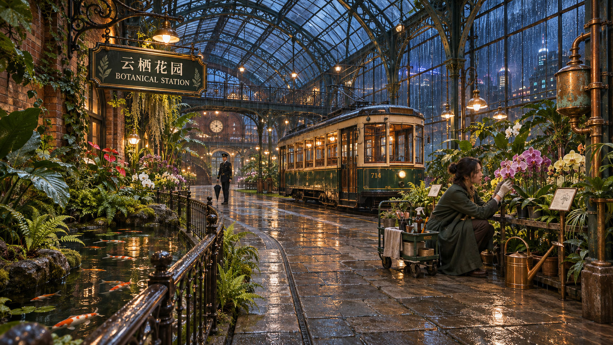

# 雨夜温室车站：文生图 → 图生图

2026年11月8日（America/Los_Angeles）的单次样例。先生成雨夜温室车站，再把同一张图编辑成冬日晴朗清晨。作为可复核的生成/编辑参考与后续回归样例长期保留；本次归档没有重新调用服务，没有放大或重新编码图片。

[打开双图对照](index.html) · [原始文件核验](verification.json) · [返回测试归档](../README.md)

## 实际结果

| 项目 | 文生图 | 图生图 |
| --- | --- | --- |
| 操作 | `generate`，`/images/generations` | `edit`，`/images/edits` |
| 请求模型 | `gpt-image-2.6-sunburst` | `gpt-image-2.6-sunburst` |
| 请求质量 / 规划复杂度 | `max` / `high` | `max` / `high` |
| 请求尺寸 | 2560×1440 | 2560×1440 |
| 实际格式与尺寸 | PNG，1672×941 | PNG，1672×941 |
| 图像输入 | 无 | 左侧文生图原图，输入哈希已核对 |
| 完成记录 | `completed`，一次提交 | `completed`，一次提交 |

**两张图片均没有满足请求尺寸，不能作为原生2K成功案例。** 当时 `require_exact_size=false`，CLI产图成功不等于精确尺寸验收通过。模型和质量字段表示请求设置，不是已独立验证的上游模型身份或执行参数。

## 对照图与目视观察

### 01 文生图：雨夜温室车站

[原始提示词](01-文生图-提示词.txt) · [生成来源记录](01-text-to-image.png.cm.json)

可见玻璃拱顶、铸铁结构、池塘、复古电车、两名人物，以及“云栖花园 / BOTANICAL STATION”标牌。画面表现为室外蓝色雨夜与室内暖灯，石板和玻璃有明显湿润反光。

### 02 图生图：冬日晴朗清晨

[原始提示词](02-图生图-提示词.txt) · [编辑来源记录](02-image-to-image.png.cm.json)

大体机位、玻璃顶、电车、池塘、植物架和两个人物的站位得以保留，主要标牌文字仍可读。室外转为晴朗暖色清晨，外部屋顶与玻璃边缘出现雪霜，室内植物没有被改成雪景；石板和植物受光随之改变。

这是当前助手同会话的目视对照，结论限于上述可见变化与大体布局保留。它提供完整的文生图→原图编辑链路，不构成模型排名、长期稳定性或所有局部细节严格一致的验证。

## 证据与使用方式

- 两张原图、两份提示词、两个 `.cm.json` 来源记录均按原始字节保存。
- 已解码确认格式和尺寸，并核对输出SHA256、提交提示词SHA256及编辑基底SHA256。
- 提示词文件保留原始换行；CLI读取文本时统一换行并去除首尾空白，因此“文件字节哈希”和“提交提示词哈希”不同。两种值均见 `verification.json`，其文本内容已核对。
- 来源记录保留生成时的绝对路径；搬动或克隆仓库后，按本目录的相对文件名定位素材。
- `.cm-jobs/` 是本机运行账本，由既有 `.gitignore` 排除，不随此案例提交。
- 可离线打开对照页、图片和来源记录。以后重做回归时使用当前技能CLI，将新输出写入单独目录，保留本案例作为比较基底。
